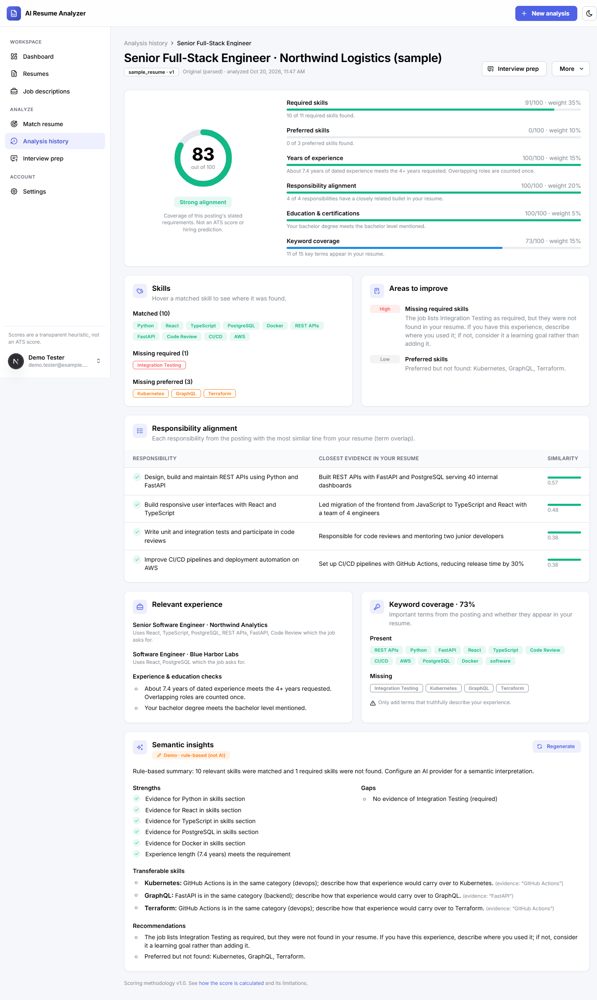
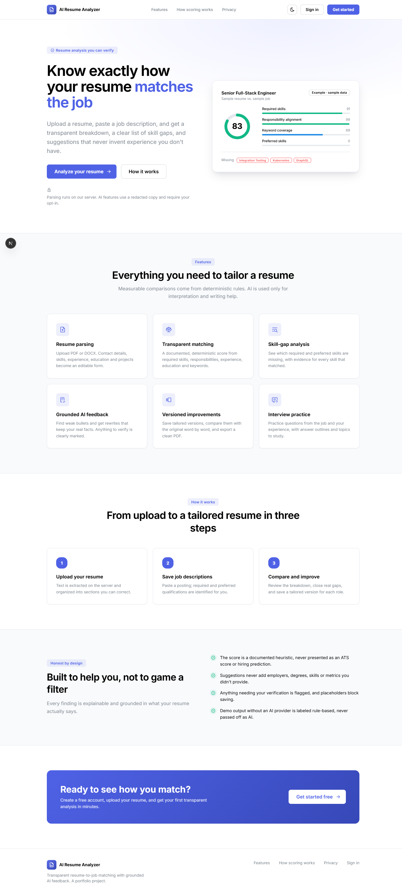
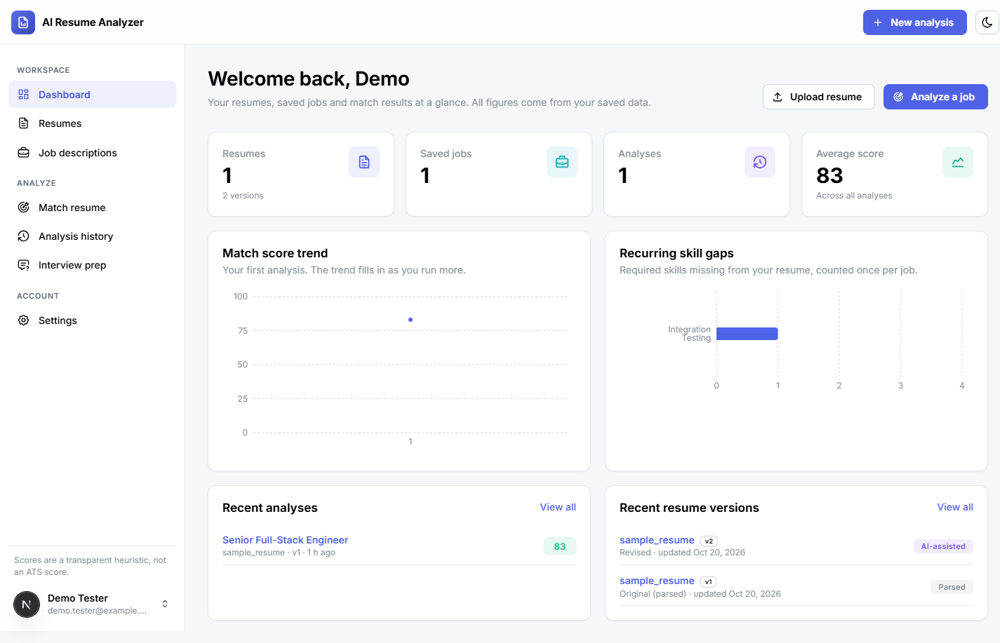
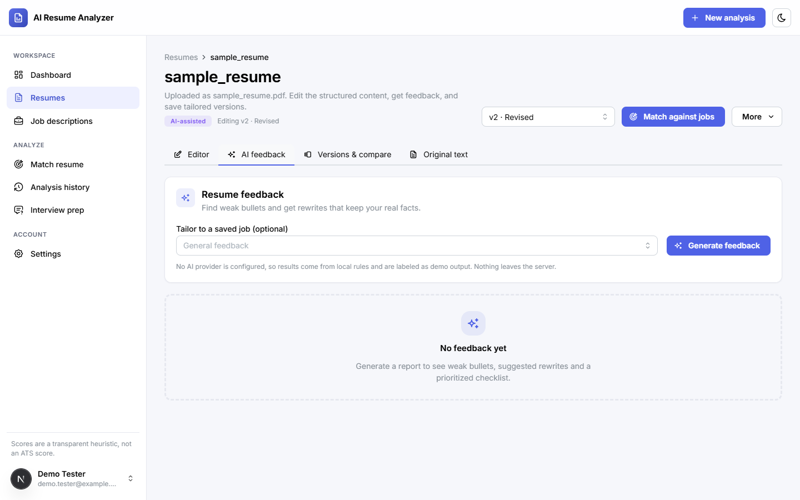
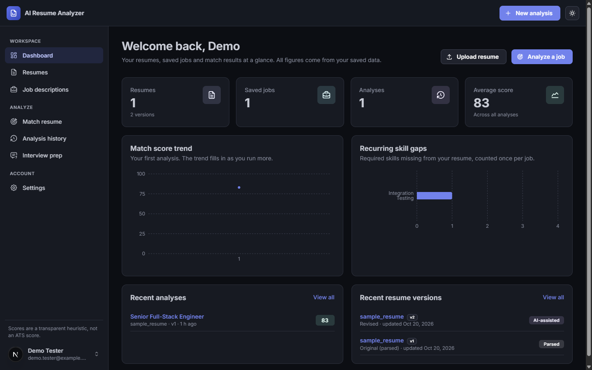
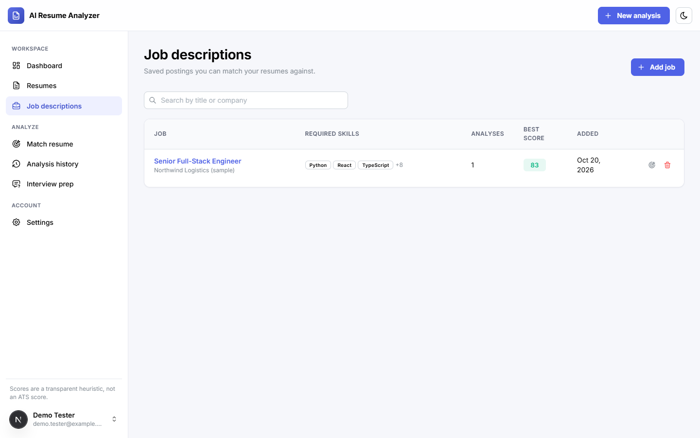

# AI Resume Analyzer & Job Matcher

A full-stack web application that compares a resume with job descriptions, explains the match with a
transparent, deterministic score, highlights real skill gaps, and helps improve the resume with
AI-assisted feedback that is grounded in what the resume actually says.

**Live demo:** https://ai-resume-analyzer-sabin.netlify.app · **API docs:** https://ai-resume-analyzer-api-pibq.onrender.com/docs

> The demo runs on free tiers: the API sleeps when idle, so the first request after a while can take
> about a minute (retry if the first sign-in times out). It uses the rule-based demo AI provider, and
> uploaded files are not kept across API restarts. Please don't upload a real resume to the demo.



> Screenshots show the running application with a fictional sample resume ("Alex Rivera") and the
> rule-based demo provider. No real personal data.

## Highlights

- **Resume parsing**: PDF (PyMuPDF) and DOCX (python-docx) upload with content-signature, size, page
  and zip-bomb checks. Text is parsed locally into contact, summary, skills, experience, education,
  projects and certifications, all editable.
- **Job analysis**: required vs. preferred skills, responsibilities, minimum years, education level,
  certifications and keywords are extracted from a pasted posting. Skill lists are editable.
- **Deterministic matching engine**: a weighted, documented score from six components with per-skill
  evidence, responsibility-to-bullet alignment, experience and education checks, and prioritized
  improvement areas. [How the score works →](docs/scoring.md)
- **Grounded AI layer**: provider interface with an OpenAI-compatible implementation (strict JSON-schema
  outputs validated by Pydantic) and a clearly labeled rule-based demo provider. Redaction, consent,
  rate limits and post-validation guardrails flag or drop anything not supported by the resume.
- **Improvement workspace**: apply suggestions to a draft, edit freely, save versions, see word-level
  diffs against the original, export clean PDFs. Saving is blocked while `[placeholders]` remain.
- **History & dashboard**: searchable, filterable analysis history; compare jobs for one resume or
  versions for one job; score trend and recurring skill gaps, all computed from saved data.
- **Interview preparation**: technical, behavioral and project questions with answer outlines tied to
  resume evidence, explicitly presented as practice material.
- **Polished, consistent UI**: a small design system (theme tokens, light and dark palettes) and
  reusable building blocks (`SectionCard`, typed `DataTable`, `StatCard`, `QueryBoundary`, pickers),
  responsive from phone to desktop, with accessible labels, keyboard focus and clear empty, loading and
  error states.
- **Security & privacy**: Argon2 password hashing, httpOnly SameSite cookies, CSRF header check,
  ownership checks on every resource (404 for others' data), safe error envelopes, no sensitive logging,
  password reset, full account deletion.

## Tech stack

| Layer | Technologies |
|---|---|
| Frontend | Next.js 15 (App Router), React 19, TypeScript (strict), Mantine 8, TanStack Query 5, React Hook Form + Zod 4, Recharts 3 |
| Backend | Python 3.12, FastAPI, Pydantic 2, SQLAlchemy 2.0, Alembic, PostgreSQL 17, PyJWT, Argon2, PyMuPDF, python-docx, ReportLab, httpx |
| AI | OpenAI-compatible Chat Completions with structured outputs (configurable model/base URL), rule-based mock provider |
| Testing | Pytest (real PostgreSQL), Vitest + Testing Library, Playwright |
| Quality | Ruff, mypy (strict), ESLint, `tsc --noEmit`, Husky + lint-staged git hooks |

## Architecture

```
Browser ─► Next.js ─(/api/* rewrite)─► FastAPI ─► PostgreSQL
                                          ├─► local file storage (uploads)
                                          └─► AI provider (optional, redacted, consented)
```

Backend layers: `api` (routers) → `services` (business logic: parsing, matching, AI, export) →
`repositories` (ownership-scoped queries) → `models`, with `schemas` for every contract and `core` for
config, security, errors and rate limiting. Details: [docs/architecture.md](docs/architecture.md).

```
backend/
  app/{api,core,db,models,repositories,schemas,services}/
  alembic/            migrations
  scripts/            demo seed, E2E server
  tests/              pytest suite + fixtures
frontend/
  app/                routes: (marketing), (auth), (app); pages compose feature components
  components/ui/      design-system primitives: SectionCard, DataTable, StatCard, PageHeader,
                      EmptyState, QueryBoundary, IconAction, PriorityList, BulletList, SearchInput…
  components/domain/  shared domain visuals: ScoreRing, ScoreBreakdown, SkillBadges, VersionSourceBadge
  components/layout/  app shell, navigation config, public header, user menu
  features/*/         per-domain API hooks, schemas and components (resumes, jobs, analyses, coaching…)
  hooks/              reusable state hooks (useListParams, useSelection)
  lib/                API client, theme tokens, constants, formatting, notifications
  tests/unit/         Vitest
  e2e/                Playwright
docs/                 architecture, setup, api, deployment, scoring
scripts/dev-db.ps1    optional portable PostgreSQL for Windows
```

## Quick start (Windows PowerShell)

Prerequisites: Node.js 22, Python 3.12, PostgreSQL 16+ (or run `.\scripts\dev-db.ps1 install` for a
portable, no-admin instance). Full instructions: [docs/setup.md](docs/setup.md).

```powershell
# Git hooks (repository root, once)
npm install

# Backend
cd backend
python -m venv .venv; .\.venv\Scripts\Activate.ps1
pip install -r requirements-dev.txt
Copy-Item .env.example .env        # set DATABASE_URL and SECRET_KEY
alembic upgrade head
uvicorn app.main:app --reload --port 8000

# Frontend (new terminal)
cd frontend
npm install
Copy-Item .env.example .env.local  # BACKEND_URL=http://127.0.0.1:8000
npm run dev                        # http://localhost:3000
```

Optional demo account with fictional data: `python -m scripts.seed_demo` (backend folder), then sign in
as `demo@example.com` / `DemoPassword1`.

## Environment configuration

| File | Key variables |
|---|---|
| `backend/.env` | `DATABASE_URL`, `SECRET_KEY`, `COOKIE_SECURE`, `FRONTEND_ORIGINS`, `UPLOAD_DIR`, `MAX_UPLOAD_MB`, `AI_PROVIDER`, `AI_API_KEY`, `AI_MODEL`, `AI_BASE_URL`, rate limits, `SMTP_*` |
| `frontend/.env.local` | `BACKEND_URL` (server-side only), `NEXT_PUBLIC_API_BASE_PATH` |

Only placeholder values are committed (`.env.example`). Secrets never reach the frontend bundle.

## AI provider setup

The app works fully without an API key: the default `AI_PROVIDER=mock` produces rule-based output that
is labeled **"Demo · rule-based (not AI)"** everywhere it appears. To enable a real model:

```env
AI_PROVIDER=openai
AI_API_KEY=<your key>
AI_MODEL=gpt-5-mini              # any model with JSON-schema structured outputs
AI_BASE_URL=https://api.openai.com/v1
```

Users must opt in under **Settings → AI processing**. Only a redacted copy (no name, email, phone or
links) is sent.

**Features that need external API credentials for real AI output:** semantic match insights, resume
feedback, interview preparation. Everything else (parsing, scoring, skill gaps, versions, export,
history, dashboard) is deterministic and works offline. Password-reset emails need SMTP credentials.

## Running tests

```powershell
cd backend;  pytest; ruff check app tests scripts; mypy app
cd frontend; npm run typecheck; npm run lint; npm test; npm run test:e2e
```

Latest local results (Windows 11, PostgreSQL 17.6):

| Suite | Result |
|---|---|
| Backend pytest (auth, isolation, upload validation, parsing, matching, AI providers and guardrails, analyses, dashboard) | 69 passed |
| Frontend Vitest (forms, upload, job form, result rendering, loading/error states, API client, shared UI components) | 34 passed |
| Playwright E2E (register → upload → job → analysis → results → history → sign out/in → revisit; invalid file and credentials) | 2 passed |
| Ruff, mypy strict, ESLint, TypeScript strict | clean |

All automated tests use the mock AI provider or a mocked HTTP transport: no paid API calls.

### Git hooks (Husky)

Run `npm install` once in the repository root to enable the hooks.

| Hook | Runs |
|---|---|
| `pre-commit` | ESLint (auto-fix) on staged frontend files via lint-staged, a full `tsc --noEmit`, and Ruff lint + format check on staged backend Python files |
| `pre-push` | Frontend unit tests (Vitest) and backend strict type check (mypy) |

Database-backed suites (pytest, Playwright) need PostgreSQL, so they run on demand rather than in hooks.

## Deployment

The live demo runs on **Netlify** (frontend), **Render** (API) and **Neon** (PostgreSQL), all free tiers.
`render.yaml` defines the API; `frontend/netlify.toml` and `scripts/deploy-netlify.sh` deploy the frontend
(build on Linux or WSL). Step-by-step guide and production checklist: [docs/deployment.md](docs/deployment.md).

## Known limitations

- The match score is a heuristic over a curated skill taxonomy and term overlap. It is **not an ATS
  score** and does not predict hiring outcomes. See [limitations](docs/scoring.md#known-limitations).
- Scanned/image-only PDFs are rejected with a clear message; OCR is not implemented. Legacy `.doc` is
  not supported.
- Parsing of multi-column or table-heavy layouts can misplace content; users review and correct it.
- Exported PDFs use a clean single-column layout but are not guaranteed to parse in every ATS.
- Rate limiting is in-memory (single API instance); uploads use local disk storage. Both have clear
  swap points for Redis and object storage.
- Behind a proxy, per-IP login limits see the proxy address; per-email limits still apply.
- AI calls are synchronous; very large batches would benefit from a task queue.
- Interview questions are practice material, not the employer's actual questions.

## Screenshots

| | |
|---|---|
|  |  |
|  |  |
|  | |

To refresh them: run the app with `python -m scripts.seed_demo` data (fictional), capture pages at
1440×900 (and 390×844 for mobile), and save them in `docs/screenshots/`. Never use real resumes.

## License

No license file has been added yet, so all rights are reserved by default. Add one (for example MIT)
if you want others to reuse the code.
